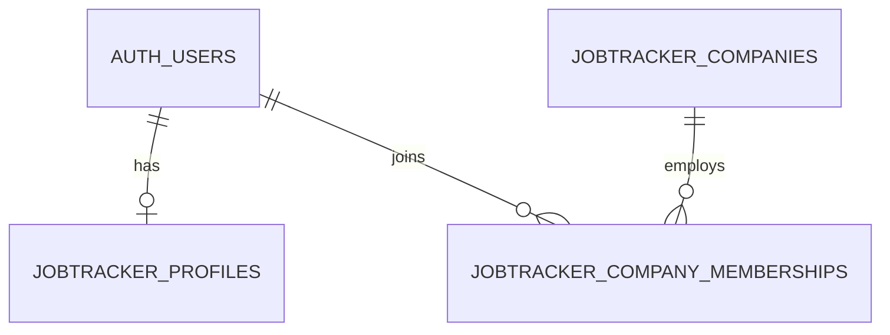

# User and company database design

Status: the user reports the initial tables have been created. The coding agent has not executed SQL or verified the live schema. See ../README.md for the implemented app and the new 003_company_setup.sql migration.

## Relationships

One company can have many staff. Each membership has a company column (`company_id`). Company names are stored once in `jobtracker_companies.name`, avoiding inconsistent spellings in user records. Profiles describe people; memberships define their permissions. A user can have memberships in several companies without duplicating their account or profile.

## Tables

### Supabase-managed `auth.users`

Use its UUID primary key as the user identity. Let Supabase manage login email, password credentials, confirmation, sessions and passkeys. Do not create custom password columns or store biometric data. Supabase's passkey implementation remains experimental; enabling it is a separate decision from this schema.

### `public.jobtracker_profiles`

| Column | Type | Rules |
| --- | --- | --- |
| user_id | uuid | Primary key; references auth.users.id |
| display_name | text | Required; trimmed length 1–100 |
| phone | text | Optional; maximum 40 characters; staff contact, not a login identifier |
| avatar_path | text | Optional private Storage object path, maximum 1024 characters |
| created_at | timestamptz | Database timestamp |
| updated_at | timestamptz | Maintained by the database |

### `public.jobtracker_companies`

| Column | Type | Rules |
| --- | --- | --- |
| id | uuid | Primary key, generated UUID |
| name | text | Required; trimmed length 1–150; names need not be globally unique |
| status | text | active or suspended; defaults to active |
| invoice_template | text | Required template key, 1–64 lowercase letters, digits, underscores or hyphens; starts with a letter; no default |
| created_at | timestamptz | Database timestamp |
| updated_at | timestamptz | Maintained by the database |

Company name alone does not identify a tenant. Authorization always uses the UUID. Invoice addresses, registration numbers and tax settings can be designed separately.

Each company explicitly selects its invoice style through `invoice_template`, for example `circuitcare_v1` or `modern_v1`. Different companies can select different templates or share a style. This column stores the key of an app-controlled layout, not executable HTML or a file path. The application must validate that the selected template exists; the database constraint validates only its format. An unknown template must produce a configuration error, without silently substituting another style. The preview, print output and shared PDF must all use the order's company template, not the currently signed-in user's company by assumption.

Template selection is company configuration, editable through the guarded owner/admin settings RPC in 003. Existing company read policies allow active members to read the selection; this addition grants no new write permissions. The application now implements both template layouts and company settings. The settings RPC is provided separately in `003_company_setup.sql`. When issued invoice records are designed, retain the template version and necessary invoice data so changing a company's selected style does not silently change previously issued invoices.

### `public.jobtracker_company_memberships`

| Column | Type | Rules |
| --- | --- | --- |
| company_id | uuid | Company column; references jobtracker_companies.id |
| user_id | uuid | References auth.users.id |
| role | text | owner, admin or staff; defaults to staff |
| status | text | active or suspended; defaults to suspended |
| created_at | timestamptz | Database timestamp |
| updated_at | timestamptz | Maintained by the database |

The primary key is `(company_id, user_id)`, preventing duplicate membership. The additional `(user_id, company_id)` index supports finding a user's companies without scanning all memberships. Suspending a company blocks company access even when its memberships remain active. Removing a company with memberships is restricted; normally suspend it instead. Deleting an Auth user removes their profile and memberships, so account deletion must be restricted to the trusted administration workflow.

## Access rules

- Anonymous clients receive no access to these three tables.
- Signed-in users can read their own profile and update only display_name, phone and avatar_path. They cannot change user_id or timestamps.
- Users can read their own memberships, including suspended ones, so the app can explain denied access.
- Users can read company details only with an active membership in an active company.
- Browser clients cannot directly create/delete profiles or change companies, memberships, roles or membership status. The guarded first-company setup and company-settings RPCs in 003 are the only implemented privileged workflows.
- Role and active status are enforced in the business-table policies and company-settings RPC. Other privileged server operations must validate the caller, company, role and status before making writes.

A confirmed account without memberships can now use the setup RPC in `003_company_setup.sql` to create its first company, profile and owner membership atomically. Additional staff onboarding requires a trusted administrator to create their profile and assign membership before inviting them. There is no automatic membership based on email domain, company name or editable user metadata. No signup trigger is introduced. Public registration should remain disabled until a deliberate signup flow is designed.

The first owner uses the guarded setup RPC after account provisioning through Supabase Auth. The future management endpoint must prevent removing or suspending the last active owner, including concurrent requests. The app does not implement staff-management mutations; do not expose privileged membership mutations until it is implemented and tested. Never ship Supabase secret/service-role keys to the browser.

## Existing application integration

The repository's current migrations grant anonymous access to orders, parts and repair images. This is evidence from local files, not a confirmation of the live database's policies. These identity tables alone do not protect existing data.

Before activating login in production:

1. Obtain the current schema and policies from the owner for review; do not query production tables automatically.
2. Provision companies and their authorized memberships. The new app uses separate `jobtracker_repair_orders` and `jobtracker_spare_parts` tables, as drafted in `002_jobtracker_business.sql`; see `repair-inventory-database.md`.
3. Use the new tables' company_id ownership and company-scoped unique order/part numbers. Design company-specific private Storage paths separately.
4. Leave legacy data and policies untouched by these drafts. If importing existing records or retiring the old app is later requested, identify the owning company and plan bounded imports and the old app's access-policy cutover separately. Do not guess company ownership.
5. Use private image access appropriate for the invoice preview; signed image URLs need sufficient validity for PDF generation.
6. Test anonymous denial, cross-company denial, self-edit column restrictions, suspended membership/company denial, role changes, and the protected administration workflow in an isolated test project.

The new application loads business records only after authentication and company selection. API policies must enforce the same boundaries independently of the UI.

## SQL review and execution

`database/001_identity.sql` defines the identity tables and their access policies. It does not alter existing business tables, create Auth users, enable passkeys or modify project Auth settings.

`database/002_jobtracker_business.sql` depends on the identity draft and creates the new app's prefixed business tables. The user reports that both initial files have been applied; do not rerun them. Neither file migrates or protects legacy records. Only 003 is newly required for company setup/settings.

All application tables now use the `jobtracker_` prefix. Helpers are created in `jobtracker_private`, independently of any existing `app_private` schema. Supabase-managed `auth.users` keeps its original name. These revised files are for fresh installation only. If older drafts have already been applied, inspect object metadata and prepare an explicit migration before running them; simply rerunning does not transfer old profiles, companies, memberships or change existing business-table foreign keys.

Run it only after separate database approval and testing in a disposable Supabase project. It intentionally fails when its named objects already exist instead of silently accepting an unknown schema. Run the entire file, including timeout settings, through one dedicated connection. Schema creation is wrapped in one DO statement so statement_timeout limits the entire DDL block to four seconds; lock_timeout limits each lock wait to two seconds. A timeout rolls back the block; investigate rather than removing the limits or retrying repeatedly against production. These settings are guardrails, not a guarantee of wall-clock timing under server failure or overload. An executor should enforce the five-second operational limit and cancel if exceeded. Close the dedicated connection after running the file; its timeout settings are session-scoped.

The active-membership helper uses SECURITY DEFINER with an empty search_path and fully qualified references to avoid recursive row policies. Its owner must be the trusted migration/table owner, not an application login. Authenticated callers can only check their own membership because the function derives the user ID from auth.uid(). Keep the jobtracker_private schema outside the Data API's exposed schemas.

No live execution or PostgreSQL integration test has been performed for this draft.

## References

- [Supabase user data](https://supabase.com/docs/guides/auth/managing-user-data)
- [Supabase row-level security](https://supabase.com/docs/guides/database/postgres/row-level-security)
- [Supabase passkeys](https://supabase.com/docs/guides/auth/passkeys)
